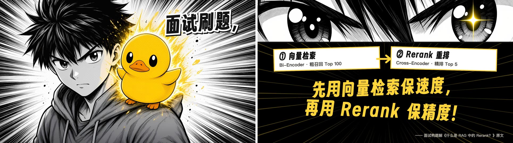

# dsh-code-video

把 **[promo-video-maker](https://github.com/liyupi/ai-promo-video-maker)** 封装成标准 DeepSeek Harness
插件的仓库。装好之后，你只需要说一句「给这个产品做支宣传片」，插件提供的工作规范就会驱动 agent
完成调研、需求问询、风格样帧、4K 截图、配乐卡点、AI 旁白、混音校验，最后交付一支 4K 宣传片。

English: [README.md](README.md)



## 它是什么

上游项目本身是一个 agent skill：`SKILL.md` 是入口，`AGENTS.md` 是约 30 KB 的制作规范，`template/`
和 `references/` 是干活时要读的资源。本仓库把这个 skill 包成一个标准 DSH 插件，于是它通过宿主的
插件管理器安装，而不是每个项目旁边都放一份克隆。

装上插件后只注册一个面向模型的 skill：`promo-video-maker`。没有新界面、没有后台服务、没有运行时
依赖——插件在加载时把包内的 `SKILL.md` 与 `AGENTS.md` 拼成 skill 正文，并把**自己安装位置的绝对路径**
注入进去，agent 不需要猜 `template/` 和 `references/` 在 pnpm profile 里的哪里。

## 包里有什么

| 路径 | 内容 |
|---|---|
| `AGENTS.md` | 制作规范：10 个阶段、节奏标准、校验闸门、脚本速查 |
| `SKILL.md` | skill 的 frontmatter（名称 + 路由描述）与简短入口 |
| `references/` | 8 份阶段手册：需求问询、风格方向、素材获取、音乐与卡点、配音、校验清单、踩坑记录、案例复盘 |
| `template/` | 可复用的 Remotion 4 + React 19 工程、网页播放页，以及约 15 个 Python 脚本（4K 截图、节拍分析、混音、闸门） |
| `docs/images/` | 上游成片的参考画面 |

产品范围很广：App、网站、SaaS、开源项目、课程、AI 模型、社区、活动，只要它有能展示的界面或作品。

## 环境要求

- DeepSeek Harness `>= 0.2.0`（插件用 `engines.dsh` 声明），Node.js 20+。
- 真要出片时，运行 agent 的这台机器还需要：Node.js 18+、**ffmpeg**、Python 3.9+，并执行
  `pip install -r <包>/template/requirements.txt`；需要 4K 网页截图时再 `playwright install chromium`。
- 可选：`ELEVENLABS_API_KEY`（放 `<工作区>/.env` 或环境变量），用于 AI 旁白、按分镜作曲与转写校验。
  没有的话自动降级为免费曲库配乐 + 大字幕。

## 安装

```sh
dsh plugin --profile web add github:Herbert-wang820/dsh-code-video
```

profile 不叫 `web` 就换成实际的。本地目录同样可以：

```sh
dsh plugin --profile web add /path/to/dsh-code-video
```

然后重启宿主、刷新页面。包里的 `lib/` 是已写好的 ESM，且不声明任何安装脚本，所以安装不需要构建，
也不需要批准脚本执行。

验证：skill 目录里应出现 `promo-video-maker`；对 agent 说「给 XX 做支宣传片」应当触发它。

宿主有插件页的话，这一行的 id 是 `code-video`。如果你更想用 `~/.dsh/skills` 里的同一份 skill，
可以在那里把它关掉。

## 怎么用

说一句话，然后回答问题：

```text
帮我给 https://example.com 做一支宣传片
给这个开源项目做一支 1 分钟的介绍视频
我们的 App 下周上线，做一支能发抖音的竖屏宣传片
```

agent 会先调研，再分两轮提问（画幅时长、受众、风格、叙事、开场钩子、声音方案、截图来源、版权、
CTA）。风格来自针对你的产品生成的 3~4 张样帧，而不是预设模板。你确认 `需求确认.md` 之后它自主
推进，只在三件事上回来找你：需要登录才能截图的页面、需要试听的配乐与音色、只有你能核实的事实。

交付物落在 `<工作区>/宣传片/<中文项目名>/`：

```text
宣传片 4K.mp4     需求确认.md     调研笔记.md     网页版/     工程/
```

## 它驱动的流程

1. 环境体检 `doctor.py`（只检查不安装）
2. 预调研：先确认产品确实有官方来源，再谈怎么做
3. 需求问询：唯一强制的人工卡点，配可视化风格样帧
4. 建项目：复制 `template/`，写 `timing.json`（时间的唯一真相）、主题、字体
5. 深度调研：Playwright 截 4K 页面，每条事实都记出处
6. 配乐与节拍：ElevenLabs 按分镜作曲，或 Mixkit 曲库 + `music.py analyze/grid/bars`
7. 分镜制作：每个场景一个 React 组件，接绝对时间，时间窗外返回 `null`
8. 配音与混音：`elevenlabs.py vo` 生成并转写校验每句，`mix.py` 自动压低音乐
9. 校验循环：`check:assets`、`lint`、逐场景截图人工审、`check_video.py`
10. 导出与改版：4K 渲染、闸门、交付；只改声音时换音轨不重渲染

节奏有硬标准：3 秒内出痛点、5 秒内第一个高能点、快切单镜 ≥ 0.65 秒、带名字的重点镜头 ≥ 1.3 秒、
网址上屏 ≥ 3 秒、全片 45~60 秒、真实截图不少于 8 张。

## 插件是怎么做的

```
package.json      dsh.bundle.patch → ./cordis.patch.yml
cordis.patch.yml  一行 loader 条目：{ id: code-video, name: dsh-code-video }
lib/index.js      Cordis 插件：ctx.skills.register(createSkillDefinition())
```

- `name = 'code-video'`、`inject = ['skills']`、`apply(ctx)` 只注册一个 skill。
- 正文 = 前言 + `AGENTS.md`；前言把 `<工具目录>`（本包）与 `<输出目录>`（`<工作区>/宣传片`）解析成
  实际路径，并写清它与「克隆用法」的差异。
- `source: 'bundled'`，`resourceBase` 指向包根，供需要文件预览的发现端解析相对资源。
- 缺 `SKILL.md` / `AGENTS.md` / `template/package.json` / `references/需求问询.md` 时直接让插件加载
  失败并给出可执行的修复提示，而不是注册一个残缺的 skill。

**同名 skill 的优先级：** 运行时注册的 rank 是 250。项目级 `.dsh/skills/promo-video-maker`（rank 100）
依然优先于本插件；用户级 `~/.dsh/skills/promo-video-maker`（rank 400）会被本插件覆盖。如果你手工
维护过 `~/.dsh/skills` 里的副本，请关掉这一行，或改掉那份副本的 `name`。

## 开发

```sh
npm test        # 契约测试：清单、注册载荷、注入路径、失败路径
```

测试不需要 DSH 宿主（用假的 `ctx.skills`），并会校验正文里提到的每个路径在包内真实存在。
`lib/` 是手写 ESM，没有构建步骤。

从上游同步：

```sh
cp <上游>/{AGENTS.md,SKILL.md,CLAUDE.md,.env.example} .
cp -R <上游>/references <上游>/template .
npm test
```

## 兼容性与授权

- DSH `>= 0.2.0 < 0.3.0`（`engines.dsh`），Node.js 20+。
- 本插件：MIT。
- 打包的制作流程与模板来自 [liyupi/ai-promo-video-maker](https://github.com/liyupi/ai-promo-video-maker)
  （MIT，Copyright © 2026 程序员鱼皮）。改动清单见 [NOTICE](NOTICE)。
- **Remotion 授权**：个人与 3 人以内公司免费，更大的团队需要购买公司授权，见
  [remotion.dev/license](https://www.remotion.dev/license)。
- ElevenLabs 免费套餐生成的内容不可商用。
- 素材版权由使用者负责；流程会在开工前和你确认边界，并把每张素材的出处记进 `调研笔记.md`。
